# robot-dispatch

<p align="center">
  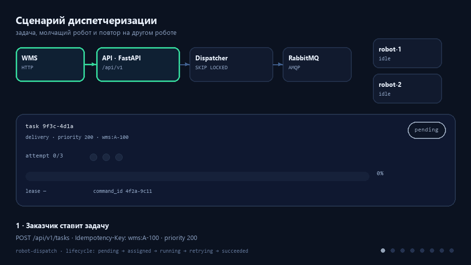
</p>

*Восемь кадров одного сценария: задача создаётся, робот её берёт и замолкает — lease истекает,
задача возвращается в очередь, второй робот доводит её до успеха. GIF собирается командой `make docs`.*

<p align="center">
  <a href="https://kepanasyuke.github.io/robot-dispatch/dispatch/"><b>▶ Открыть демо-консоль</b></a>
  ·
  <a href="https://kepanasyuke.github.io/robot-dispatch/">Покрытие тестами</a>
  ·
  <a href="https://kepanasyuke.github.io/robot-dispatch/game/">Игра «Диспетчер роботов»</a>
</p>

Демо-консоль работает без бэкенда: данные лежат в памяти браузера, создание и отмена
задач доступны сразу после входа.

## Простыми словами

Это диспетчерская для парка роботов: складская система присылает задачи, диспетчер раздаёт их роботам, собирает телеметрию и показывает, что происходит с флотом. Если робот потерял связь, его задача возвращается в очередь и достаётся другому — работа не встаёт.

Внутри несколько самостоятельных сервисов на Python: диспетчер задач, приём телеметрии, мост к ROS2, мониторинг и интеграция с WMS заказчика. Они общаются через RabbitMQ и HTTP, состояние хранят в PostgreSQL.

Монорепозиторий backend-проектов для команды разработки роботов: диспетчеризация задач,
телеметрия, мост к ROS2, gRPC-плоскость управления, мониторинг флота и интеграция с WMS заказчика.

Каждый проект самостоятелен, но они складываются в одну систему: робот шлёт телеметрию →
монитор поднимает алерты → диспетчер ставит задачи → мост отдаёт команды в ROS2 → результаты
возвращаются в диспетчер → WMS получает статусы.

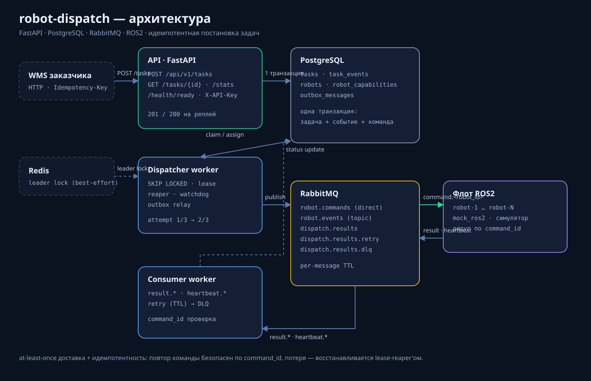

## Проекты

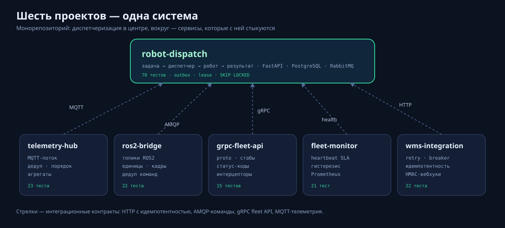

| Проект | Что демонстрирует | Стек | Тесты |
|---|---|---|---|
| [robot-dispatch](src/robot_dispatch) | диспетчеризация: очередь задач, lease-восстановление, транзакционный outbox, REST API | FastAPI, PostgreSQL, RabbitMQ, Redis | 139 |
| [telemetry-hub](projects/telemetry-hub) | ingest MQTT с дедупликацией, порядком и backpressure, rolling-агрегаты | FastAPI, pydantic, aio-pika (MQTT) | 23 |
| [ros2-bridge](projects/ros2-bridge) | контракт сервер ↔ ROS2: топики, нормализация единиц, дедуп команд, таймауты фидбэка | pydantic, asyncio | 22 |
| [grpc-fleet-api](projects/grpc-fleet-api) | gRPC-плоскость: канонические статус-коды, идемпотентный `DispatchTask`, интерцептор метрик | grpcio, protobuf | 15 |
| [fleet-monitor](projects/fleet-monitor) | правила алертов с гистерезисом, жизненный цикл open/acked/resolved, Prometheus | FastAPI, Prometheus text | 21 |
| [wms-integration](projects/wms-integration) | устойчивый HTTP-клиент (retry, circuit breaker), идемпотентный синк заказов, подписанные вебхуки | httpx, HMAC | 22 |

Суммарно: **321 python-тест**, **344 теста веб-консоли**, **40 E2E**;
`ruff` и `mypy` без замечаний, CI на каждый push.

## Игра

<p align="center">
  <a href="https://kepanasyuke.github.io/robot-dispatch/game/">
    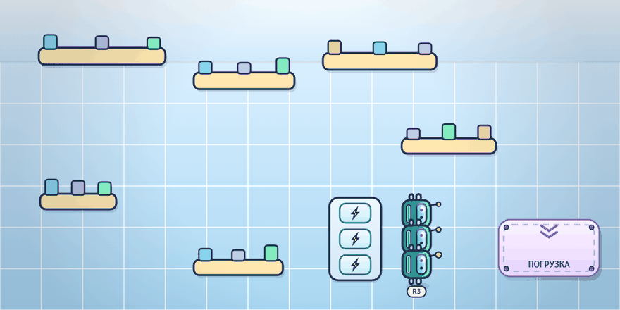
  </a>
</p>

«Диспетчер роботов» — мини-игра на ту же тему: заказы-кубики появляются на складе, нужно назначать
свободных роботов, следить за зарядом и не давать заказам просрочиться.

Правило повторной постановки взято из сервиса: если робот не довёз заказ (разрядился или истёк
дедлайн), задача возвращается в очередь с новой попыткой — до трёх, после чего теряется жизнь.
Заказ, который никто не взял, сгорает сразу.

Играть: [kepanasyuke.github.io/robot-dispatch/game](https://kepanasyuke.github.io/robot-dispatch/game/) ·
исходник: `docs/game/index.html` — один файл, без зависимостей, сети и сборки.

## Быстрый старт

```bash
make install     # или: python scripts/dev.py install
make check       # ruff + mypy + pytest
make up          # docker compose: postgres, rabbitmq, redis, api, dispatcher, consumer, 2 робота
```

`make` — тонкая обёртка над `python scripts/dev.py`; на Windows без GNU make используйте второй вариант,
команды идентичны.

| Команда | Что делает |
|---|---|
| `install` | установить пакет с dev-зависимостями |
| `lint` / `format` | ruff check / autofix + format |
| `typecheck` | mypy (73 файла) |
| `test [путь]` | pytest: всё или конкретный проект |
| `check` | lint + typecheck + test |
| `proto` | перегенерация gRPC-стабов (включая `.pyi`) |
| `docs` | пересборка GIF-анимации и проверка SVG-схем |
| `projects` | список проектов репозитория |
| `up` / `down` / `logs` / `migrate` / `sim` | docker-compose и локальный симулятор флота |

```bash
python scripts/dev.py test projects/ros2-bridge
python scripts/dev.py projects
```

## robot-dispatch: ключевые решения

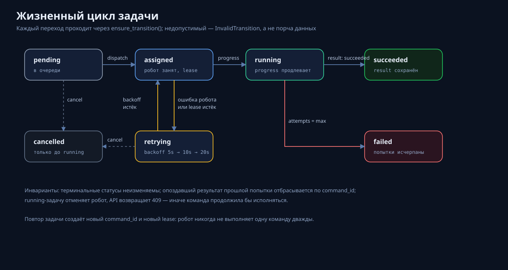

| Отказ | Механизм |
|---|---|
| Два диспетчера взяли одну задачу | `SELECT ... FOR UPDATE SKIP LOCKED` |
| Падение между назначением и публикацией | транзакционный outbox: задача + состояние робота + команда в одной транзакции |
| Брокер недоступен | outbox повторяет публикацию с backoff |
| Робот молча умер | lease на попытку, `LeaseReaper` возвращает задачу в очередь |
| Робот вернул ошибку | экспоненциальный backoff с потолком, затем `failed` |
| Дубликат/опоздавший результат | проверка `command_id`, терминальные статусы игнорируются |
| Повторный POST заказчика | `external_id` / `Idempotency-Key` + уникальный индекс → 200 вместо 201 |
| Битое сообщение от робота | немедленный dead-letter |
| Сбой обработчика | retry-очередь с TTL, затем DLQ |

Подробности — в коде: `src/robot_dispatch/services/dispatcher.py`,
`src/robot_dispatch/messaging/outbox_relay.py`, `src/robot_dispatch/domain/state_machine.py`.

## Веб-консоль флота (`web/`)

Отдельное SPA поверх существующего API: очередь задач с фильтрами, карточка задачи с
полной историей событий, парк роботов и состояние сервиса. Бэкенд не менялся, кроме
одной правки валидации: `type` из одних пробелов теперь отклоняется, а не превращается
в пустую строку.

<p align="center">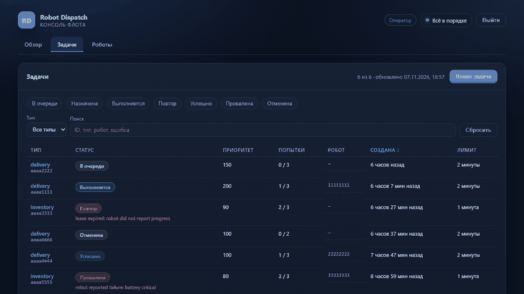</p>

| Обзор | Задачи |
| --- | --- |
| 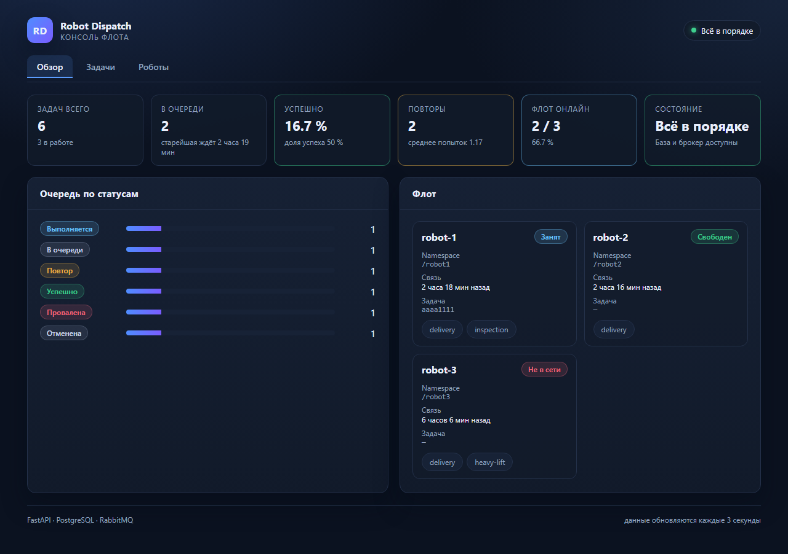 | 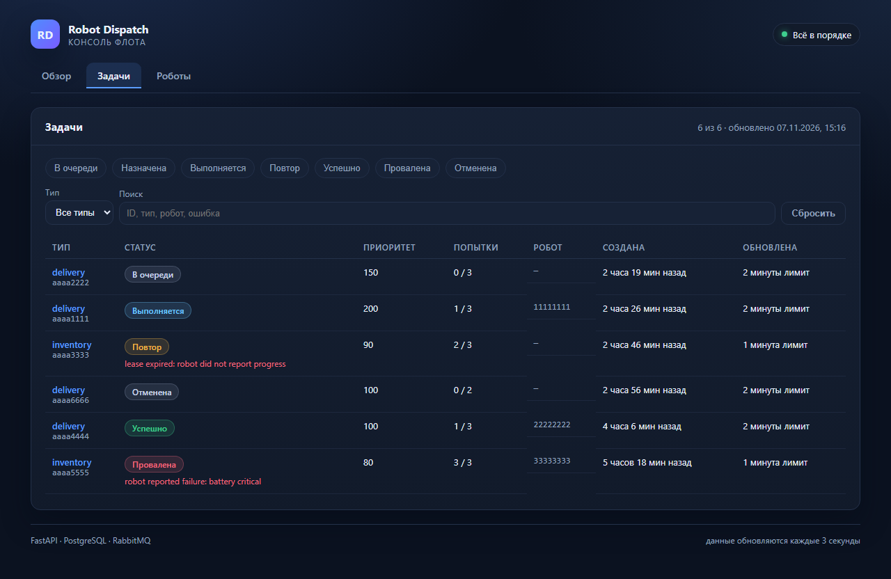 |
| **Карточка задачи** | **Роботы** |
| 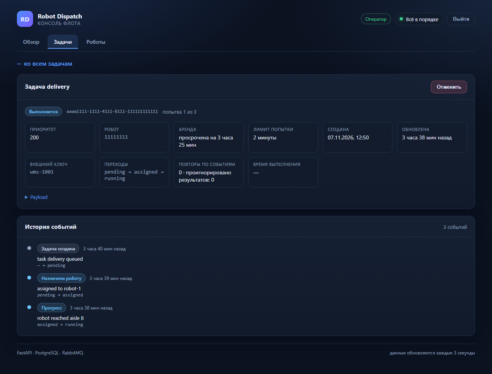 | 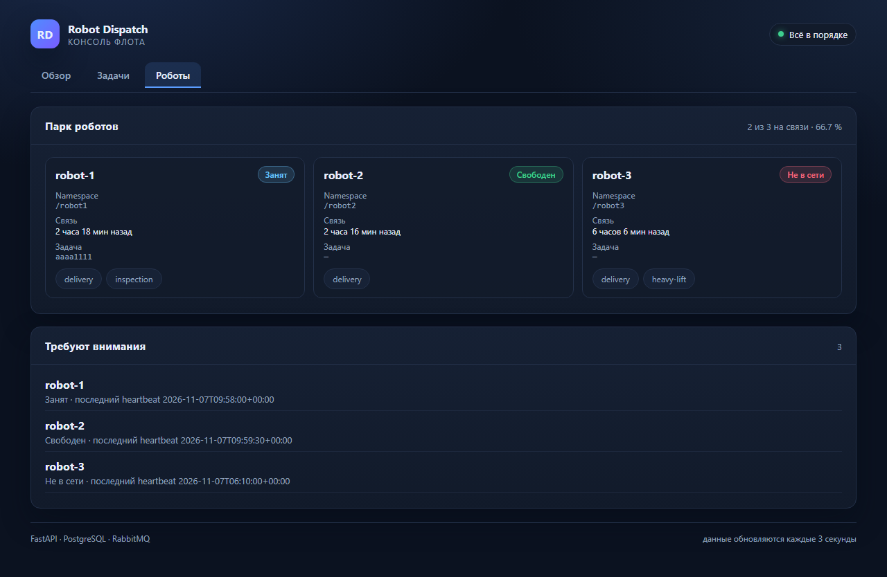 |
| **Вход и роли** | **Новая задача** |
| 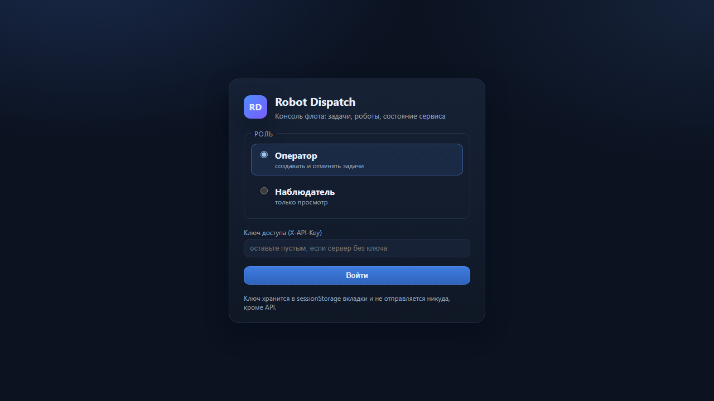 | 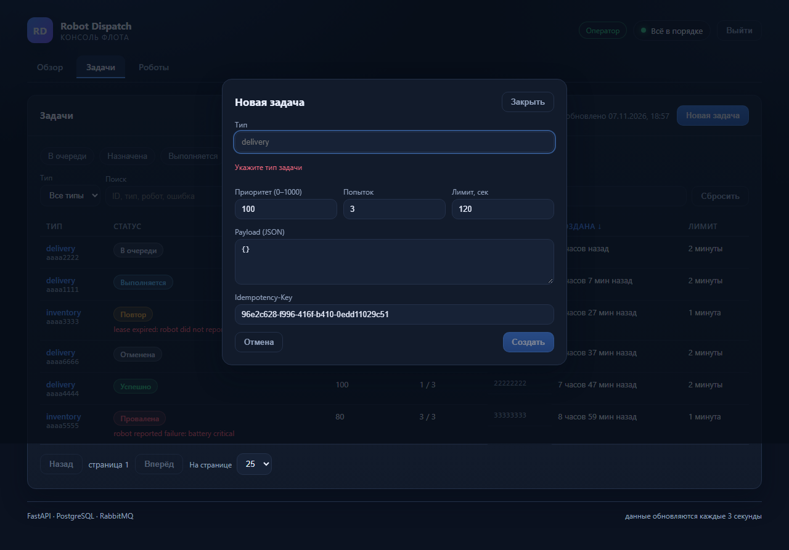 |
| **Уведомление после создания** | |
| 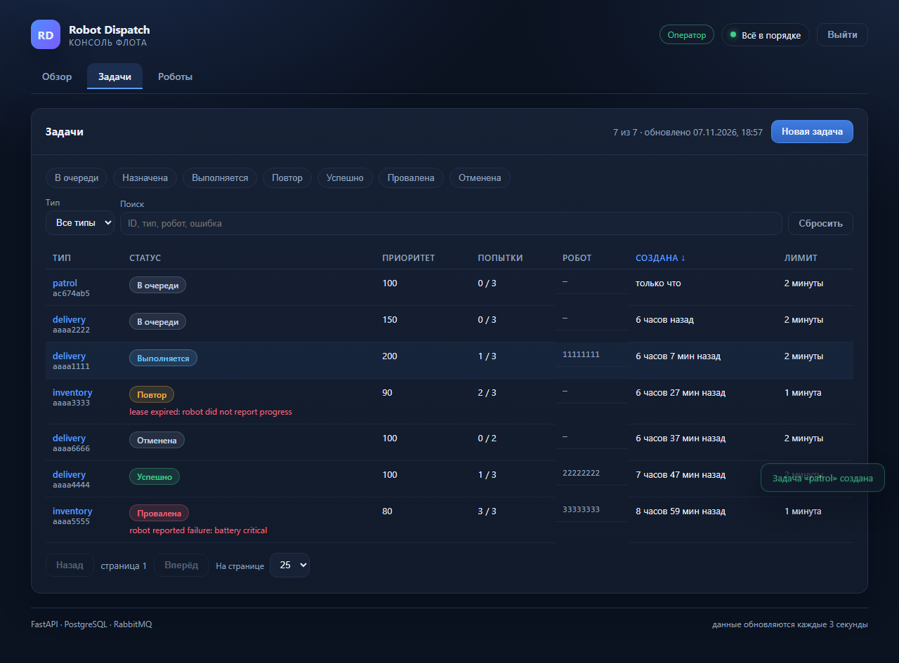 | |

Что важно в реализации:

- **Вход и роли.** На старте — экран входа: `X-API-Key` (можно оставить пустым, если сервер
  без ключа) и роль. «Оператор» создаёт и отменяет задачи, «наблюдатель» только смотрит:
  кнопки заблокированы с подсказкой причины. Ключ живёт в `sessionStorage` вкладки.
- **Создание задачи из интерфейса.** Форма с типом, приоритетом, payload (JSON проверяется
  до отправки), лимитами и `Idempotency-Key`: повторная отправка того же ключа возвращает
  существующую задачу, а не дубль.
- **Ошибки не теряются.** `ApiError` отличает сетевой сбой (`status = 0`) от ответа сервиса;
  `detail` из FastAPI (строка или список полей валидации) превращается в читаемый текст,
  а страница показывает баннер с кнопкой «Повторить» вместо пустого экрана.
- **Живые данные.** Опрос раз в 3 секунды с отменой запроса при размонтировании;
  отдельно запрашиваются `/health/live` и `/health/ready`, и «деградация» — это не «упало».
- **Чистая логика отдельно от React.** Форматирование, фильтры, сортировка, схлопывание
  истории, права по роли и сводка по флоту живут в `web/src/lib/*` и покрыты тестами без браузера.
- **Демо без бэкенда.** `npm run build:demo` собирает консоль с in-memory API на фикстурах:
  страница `…/dispatch/` показывает рабочий интерфейс без PostgreSQL и RabbitMQ.

Запуск:

```bash
# 1. бэкенд (нужны postgres/rabbitmq) — или mock для демо
docker compose up -d
cd web && npm install && npm run dev        # http://localhost:5173

# 2. демо без бэкенда: mock-API на фикстурах
npm run mock-api                            # http://127.0.0.1:8787/api/v1
VITE_API_BASE=http://127.0.0.1:8787/api/v1 npm run build && npm run preview
```

Проверки:

```bash
cd web
npm run typecheck      # tsc --noEmit
npm run test           # 344 unit и компонентных тестов (vitest + jsdom)
npm run test:coverage  # HTML-отчёт v8 в web/coverage
npm run e2e            # 40 сценариев Playwright на mock-API
```

Покрытие: `python -m pytest tests projects --cov=src/robot_dispatch --cov-report=json:coverage-python.json`
и `npm run test:coverage`, затем `python scripts/build_coverage_site.py` — собирает
`coverage-site/index.html` со сводкой по обоим наборам и ссылками на полные отчёты.
Сейчас: **Python 95,5 %**, **TypeScript 97,9 %**. Самая слабая зона — точки входа
воркеров (`workers/*main`, запускаются только в контейнере) и `repositories/memory.py`
на редких ветках; они помечены в отчёте, а не спрятаны. Публикация — workflow
`.github/workflows/coverage.yml` (GitHub Pages).

Ограничения: консоль только читает и отменяет задачи — создание доступно через API;
WebSocket-обновлений нет, поэтому задержка до 3 секунд; mock-API не заменяет
интеграционный прогон с PostgreSQL и RabbitMQ.

## Структура

```
src/robot_dispatch/        основной сервис диспетчеризации
  api/  db/  domain/  repositories/  services/  messaging/  workers/  infra/
web/                       веб-консоль (Vite + React + TS), mock-API и E2E
coverage-site/             сводный отчёт покрытия (собирается скриптом)
mock_ros2/                 симулятор флота (регистрация, команды, прогресс, heartbeat)
projects/
  telemetry-hub/           ingest и агрегаты телеметрии
  ros2-bridge/             мост к ROS2-топикам
  grpc-fleet-api/          gRPC-контракт и сервер
  fleet-monitor/           алерты и метрики
  wms-integration/         клиент и вебхуки WMS
migrations/                Alembic
scripts/dev.py             кросс-платформенный раннер (он же — цели Makefile)
tests/                     тесты основного сервиса
```

У каждого проекта в `projects/` есть свой README с деталями контракта и решениями.

## Инженерные принципы репозитория

* **Домен отделён от I/O**: статусы и переходы — `domain/`, транспорт — `messaging/`, хранилище — `repositories/`.
* **Один контракт, две реализации**: SQL и in-memory Unit of Work; тесты не требуют PostgreSQL и RabbitMQ.
* **Валидация на границе**: pydantic-схемы на входе любого внешнего канала (HTTP, MQTT, gRPC, webhook).
* **Честная типизация**: `mypy` проходит по 73 файлам, включая сгенерированные gRPC-стабы через `.pyi`.
* **Тесты как документация отказов**: каждый сценарий (stale lease, replay вебхука, half-open breaker)
  воспроизводится детерминированно.

## Что дальше

* gRPC-адаптер для `robot-dispatch` поверх тех же сервисов (транспорт уже отделён).
* Prometheus-экспорт метрик диспетчера (сейчас `/api/v1/stats`).
* Пул слотов на робота вместо `current_task_id`.
* Интеграционные тесты с testcontainers на PostgreSQL и RabbitMQ.
